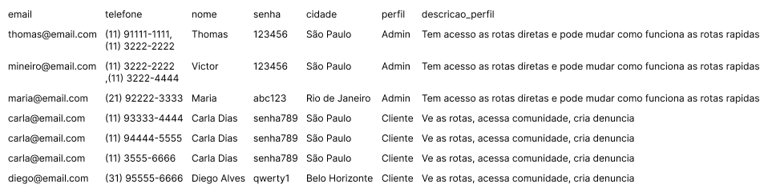
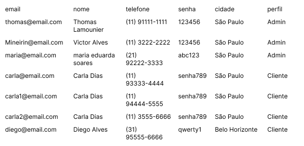
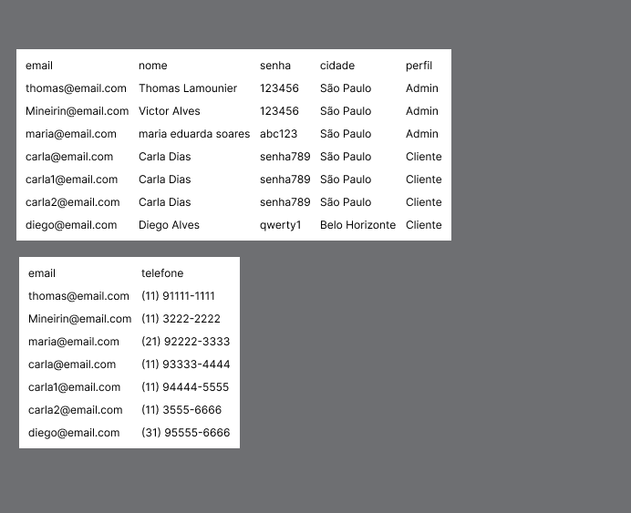
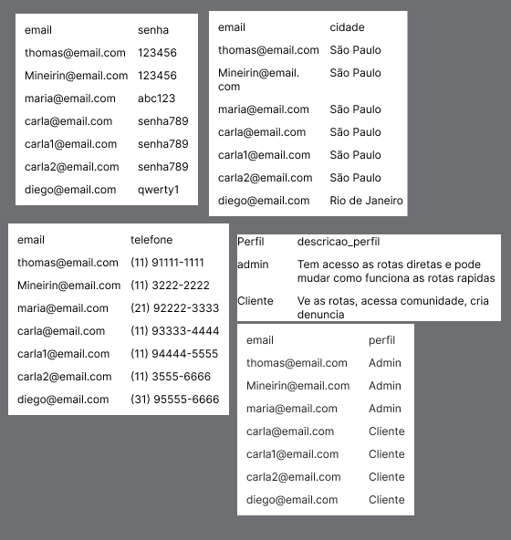
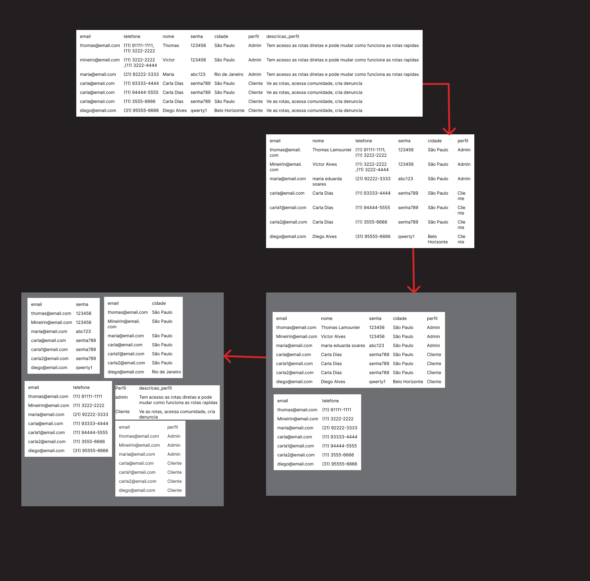
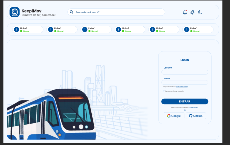
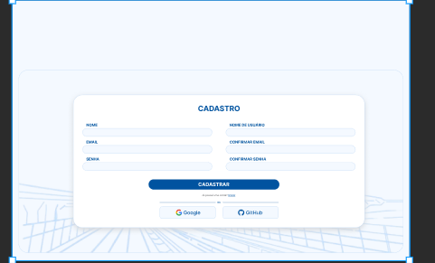
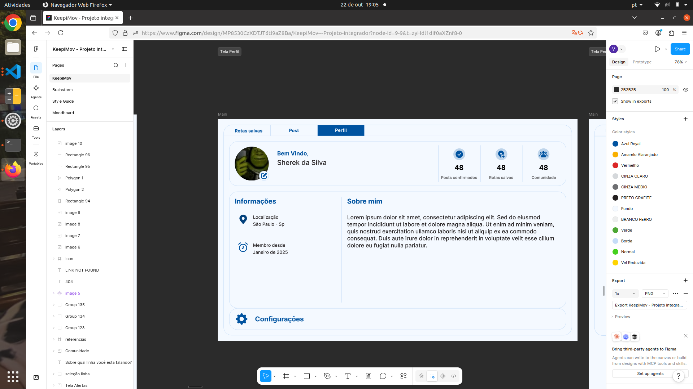
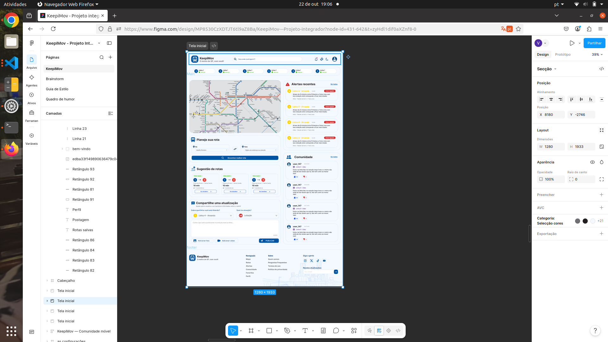

# ADO-01
| Integrante | GitHub | Responsabilidade |
| --- | --- | --- |
| Thomas lindão | @tthomaslamouniercarvalho-dotcom | Normalização das tabelas aplicada |
| Victor Mineirin | @victoralvez07 | Telas relacionais e das telas ás entidades |
| Maria Bacanuda | @mardudasoares | fundamentação |
| Lucas Vilão | @lucascorreaa | Supervisor de trabalho Premium |

## Modelagem conceitual, lógica e fisica
### modelo conceitual

### modelo físico
#### Podemos observar a implementação de conceitos relacionados a tipo de dados, quantidade de caracteres, identificação das chaves primárias e estrangeiras além das restrições de integridade, tudo definido de acordo com o SGBD ecolhido.

### modelo lógico
#### no modelo lógico a preocupação é passar todo o conceito do  modelo conceitual para a versões em tabelas e seus relacionamentos definindo atributos, chaves primárias e estrangeiras.

### modelo conceitual
#### no modelo conceitual a preocupação é identificar as entidades, atributos e relacionamentos do negócio, de forma simples e sem detalhes técnicos

## MER e DER
#### o MER (Modelo Entidade-Relacionamento) é o modelo que define os conceitos de entidades, atributos e relacionamentos, e o DER (Diagrama Entidade-Relacionamento) é o diagrama que representa esses conceitos graficamente

#### * Entidade = a tabela
#### * Atributo = a coluna
#### * PK (Primary Key) = o “CPF” do registro precisa ser único
#### * FK (Forgeign Key)= o “link” que aponta para a PK de outra tabela

## relacionamentos e cardinalidade
#### os relacionamentos ligam as entidades entre si, e a cardinalidade define quantos registros de uma entidade podem se relacionar com a outra: 1:1 (um para um), 1:N (um para muitos) e N:N (muitos para muitos). Como o N:N não pode ser representado diretamente em tabelas, ele é transformado em uma tabela associativa, que recebe as chaves primárias das duas entidades como chaves estrangeiras (ex: linha_estacao, ligando linha e estacao)

### normalização
#### a normalização organiza as tabelas para eliminar redundância e evitar anomalias de inserção, atualização e exclusão. A 1FN exige valores atômicos em cada campo, a 2FN exige que nenhum atributo dependa de apenas parte da chave composta e a 3FN exige que nenhum atributo dependa de outro atributo que não seja chave

## Modelagem Física
#### * INT - números inteiros
#### * VARCHAR(X) -  texto de até x caraccteres
#### * DATE -  data
#### * PRIMARY KEY - chave primária
#### * FORGEIGN KEY - chave estrangeira
#### * NOT NULL - campo obrigatório
#### * UNIQUE - não permite registros repetidos
#### * AUTO_INCREMENT - aumenta automaticamente (1, 2, 3)
#### * ENUM - limita as opções

#### SANTOS, Ozias Gonçalves dos. Banco de dados. São Paulo: Senac, 2026. Notas de aula.

#### Integrante: Maria Eduarda Soares
#### ANTHROPIC. Claude (modelo utilizado: Claude Sonnet 5.5). Ferramenta de inteligência artificial generativa.
#### Data de uso: 23 out. 2026.
#### Finalidade: verificação e revisão de textos feitos em estudos sobre modelo conceitual, lógico e físico, MER/DER.
#### Arquivos impactados: README.md (seção Modelagem)

** Normalização aplicada**

- mostrar uma tabela do projeto em uma versão não normalizada (como alguém faria sem pensar no modelo) e o passo a passo até a 3FN
- explicar em cada passo o que foi corrigido e por quê

#exemplo de table não formalizada
  
  essa tabela não formalizada usada como exemplo com dados que usaremos no nosso site(talvez haja alterações)
  aplicando a normalização da tabela como requerido
  
  
  aplicando a 1FN a gente deixa todos os dados de maneira atomica com um unico dado dentro de cada seção
  
  
  Aqui aplicando a 2FN tirando e separando as tabelas unicas (que só se pode ter 1 como só 1 telefone e 1 email ) e normalizando as informações mantendo as primarias não juntando com as primarias
  e fazendo os dados da tabela se separar ja que email e telefone são dois jeitos de puxar a tabela pessoa porém só precisamos do email pra puxar a tabela pessoa então não precisamos da informação do telefone naquela tabela
  assim separando as tabelas para evitar esse acumulo de linhas em uma tabela que pode ser repartida e mantendo as informações essenciais dentro da tabela requerida
  
  
  ultima formalização da tabela fazendo os atributos comuns não dependerem de atributos comuns e se relacionarem diretamente da chave da tabela e somente com ela

  #tabela toda na ordem dos passos
  
  

  Integrante: @tthomaslamounier
Anthropic. Claude (modelo utilizado). Ferramenta de inteligência artificial generativa.
Data de uso: 24 out. 2026.
Finalidade: Esclarecimento do que se fazer no exercício dado.
Arquivos impactados: README.md (seção Normalização)

# Das telas ás entidades

A partir das telas desenvolvidas no Figma para o KeepiMov , identifiquei os dados que o sistema precisa salvar no banco de dados:

# tela de Autenticação (Login e Cadastro)

 

ao analisar a tela de entrada do KeepiMov, identificamos a necessidades de criar a tabela de usuarios para autenticação no aplicativo.

- Entidade gerada: `usuario`
  -campos identificados no figma: -`id` Codigo identificador do usuario -`nome-completo`: Nome digitado no cadastro -`email`:E-mail usado para login -`senha_hash`: Senha cadastrada pelo usuario -`data_criacao`: Data de registrono aplicativo

  ***

# Tela de perfil e configurações

Nesta tela, o usuario gerencia suas informações pessoais e preferencias de uso do aplicativo

- Entidade geradas `perfil` e `preferencia`
- Campos identificados do figma:
- Na tabela `perfil`: `foto_url`, `biografia`, `cidade_residencia`
- Na tabela `preferencia`: `notificacoes_linhas_ativas`, `tema_escuro`

---

# Tela principal (Home / Status das linhas)

tela principal do KeepiMov, o usuario acompanha a situação das linhas de metro e pode registrar alertas de incidentes

-Entidades geradas: `linha` e `alerta`
-campo identificados no figma:

- Na tabela `linha`: `nome_linha`, `status_operacao` (ex: Normal, Velocidade Reduzida)
- Na Tabela `alerta`: `tipo_incidente`, `descricao`, `horario_registro`
